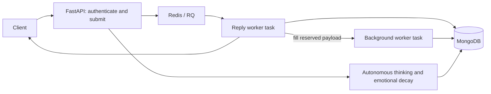

# Project Overview

## What Synthetic Soul Is

Synthetic Soul is an experimental artificial intelligence project designed to simulate human-like emotions, thought patterns, and relationship dynamics. Its purpose is to create a digital mind that not only responds to user input but also develops an evolving personality, one that reflects emotional depth, personal biases, and individualized sentiments toward different users shaped by unique experiences.

The AI is named Jasmine, short for Just a Simulation Modeling Interactive Neural Engagement, to reflect both its experimental nature and its focus on simulating authentic engagement.

## Philosophy

Synthetic Soul explores affective computing and digital companionship by blending AI with principles from psychology and relationship studies. The goal is not just interaction but evolution: an AI that grows and adapts over time based on context, continuity, and repeated user interactions.

## Runtime flow: canonical reference

This document is the single source of truth for the implemented flow, state ownership, ordering, recovery and accounting contracts. Update it alongside behavior changes. The [README](../README.md) covers installation, configuration and operational commands. Generated validation reports remain local and untracked; they describe particular past revisions, not the current contract.

The runtime hosts one configured agent per process (`BOT_NAME`, default `jasmine`). Multiple users interact with the same agent state. Each user has a separate perspective profile for that agent. `MODE=lite` selects the lite state collections; other values select rich collections. No model training or provider-side persistent memory is performed: application records are retrieved and supplied as context.

### Components and startup

- FastAPI validates configuration, initializes Mongo collections, validators and indexes, refreshes the expression cache, and starts the two autonomous loops.
- Redis holds queued jobs, expiring job results, rate-limit counters and progress pub/sub events. RQ workers run synchronous task entry points over a persistent per-process asyncio loop.
- MongoDB holds durable identities, sessions, user perspectives, conversations, messages, memories, thoughts, state audits and accounting records.
- Each API process starts its own thinking and decay loops. Deploy one API process for a single loop owner; there is currently no distributed scheduler ownership. Increasing API replicas duplicates these passes.
- Workers use `SimpleWorker` on Windows and by default on macOS, with the fork worker available on supported platforms. API and workers must use matching agent, collection and provider configuration.

### State and ownership

| Record | Scope | Behavior |
| --- | --- | --- |
| Agent identity | Agent | Persistent prose, revised selectively |
| Personality | Agent baseline | Stored baseline remains stable; message deltas affect only that interaction |
| Emotions | Agent | Persistent bounded dimensions, changed by interactions, thoughts and decay |
| Expression | Agent | Installed expression asset, selected after prose or by the baseline writer |
| Summary, relationships, sentiments | User + agent perspective | Persistent factual summary and subjective relationship state |
| Conversation | User + agent | Rolling last 1,000 messages; reply context uses the last 10 |
| Message memory | Agent | Append-only message records; broader context uses the latest 10 across conversations |
| Episodic memory | Agent, optionally a user | Event, subjective reflection, significance, emotional impacts and up to three tags |
| Thoughts | Agent | Generated internal asides stored separately from public replies |

Incoming message records retain `original_message` independently of interpreted `message`, purpose and tone. Sequenced submissions also retain `interaction_sequence`. Shared context across this agent's conversations is intentional; tagged memory recall is scoped to the active agent so another agent's same-tag memories are excluded.

Memory recall currently chooses a random stored tag, retrieves up to 100 matching memories for that agent, and randomly selects one. Embedding fields exist but are not used for semantic retrieval. Thought and episodic memory records are selectively created; not every exchange becomes an episodic memory.

### Message submission and reply

1. `POST /v1/messages/submit` validates the authenticated session and input (`dm` or `group`, 1-4,000 characters), applies a per-user rate limit, and ensures the user perspective exists.
2. The API creates an exchange/job ID and accounting run. A short Redis submission lock per database/agent/user covers allocating the perspective's `interaction_sequence` and registering both jobs. Failed enqueueing can leave harmless sequence gaps.
3. One Redis transaction queues the reply, reserves its background job, registers background dependencies on that reply and the user's previous active background job, and advances the user's queue tail. The API returns `202` with the reply job ID, polling location and retry hint.
4. The worker loads agent/user state, recent conversation, broader message history and the latest thought concurrently. Group messages receive an implicit-addressing judgment; DMs skip that check.
5. State evaluation proposes emotional and personality deltas. Emotions are committed against the evaluated revision; personality changes remain interaction-local.
6. Perception supplies purpose, tone and possibly an updated thought. The original input and interpretation are persisted to conversation and message storage before reply generation continues. Native reply context retains the pre-message thought as `previous_thoughts` and includes `updated_thought` only when perception produces one, together with its directive status. Both thoughts provide continuity; fulfilled or cancelled commitments are no longer outstanding. Thought-generation rules are unchanged.
7. The pipeline retrieves memory and installed expressions, and chooses whether to respond or ignore. DMs can be deliberately ignored. An accepted Decisions participation choice cannot be reversed by the prose writer.
8. The writer produces public reply text, purpose and tone. Native reply context excludes diagnostic assistant envelopes and ends with the actual incoming user text. Expression selection follows written prose when that Decisions feature is enabled.
9. Public replies are persisted to conversation and message storage. A malformed DM generation with no valid reply can produce a deterministic request to resend; intentional ignoring stays silent.
10. The reply task saves its processing transcript into the already-reserved background job, then returns text or `null`, expression and elapsed whole seconds. Background payload persistence failure is recorded separately and does not invalidate a persisted reply. The payload belongs to the background job, so waiting for a predecessor does not depend on the reply result's retention period.

`GET /v1/jobs/{id}` and `/events` enforce ownership and expose reply progress/results through Redis. Reply success does not mean background processing is finished. Redis result expiry does not delete the Mongo accounting record.

### Background refresh and exchange order

Background work refreshes sentiments, relationship, factual user summary and potentially agent identity; considers an episodic memory; then considers a new thought and expression.

For new API submissions, RQ dependencies serialize the complete background pipeline in exchange sequence order for each database/agent/user. Replies can finish in either order, and other users' replies and background work run independently. No worker waits or sleeps for a predecessor: dependent jobs stay deferred in Redis until eligible. A failed predecessor releases its dependents; a failed reply's unfilled background slot is cancelled without model work, allowing the next exchange to continue. This guarantees ordering of attempted work, not successful persistence for a failed exchange or automatic retries of failed jobs.

The user refresh writes `last_refreshed_sequence` atomically with its fields and cognition revision. Baseline and Decisions refreshes both reject a sequence at or below the stored marker. On a revision conflict they reload the winner, so a newer refresh that commits while an older model call is running causes the older result to be discarded.

A rejected stale refresh skips the remaining optional background stages and records `stale_background_skipped` when accounting is available. This remains a defensive guard for duplicate, direct or legacy calls; newly submitted API background jobs are ordered before reaching it. Original messages remain stored. Jobs submitted before ordered reservation retain the previous enqueue path; drain those jobs before rolling out the new API and workers. A legacy queued job without a sequence can refresh an unmarked profile; once a sequenced refresh has committed, unsequenced jobs are skipped because their order cannot be proven. Direct replay reserves sequences and invokes background work sequentially.

User and agent documents are revision-checked separately, not committed in a shared transaction. The sequence guard protects the user perspective; it does not turn all agent-wide state and append-only records into a globally ordered transaction.

Native summary writing uses only the stored summary and original user-authored messages as factual sources. It is instructed to retain unrelated facts, preserve boundaries, and replace completed, cancelled or superseded plans. Summaries are limited to 1,800 characters and rejected when empty, unsupported-flagged or excessively repetitive. `summary_supported` is model-supplied, not independent factual verification. Agent identity and subjective reflection are kept separate from factual user summaries.

### Provider modes and Decisions

`LLM_MODE=hosted` uses the configured fast and quality models through OpenAI. Fast generation generally serves state, perception, profile refresh and memory; quality generation serves public replies, thoughts and outreach. `LLM_MODE=local` uses configured Ollama models through its OpenAI-compatible endpoint, with JSON/schema validation and correction retries.

Decisions is enabled by default (`DECISIONS_ENABLED=true`) and hosted-only. Set `DECISIONS_ENABLED=false` to use the generative baseline. Features can be selected individually: `addressing`, `state`, `perception`, `participation`, `relationships`, `identity_summary`, `memory`, `expressions`, `autonomy`. Disabled features use ordinary generative paths. Disabling Decisions retains accounting, revision checks, exchange ordering and storage failure propagation.

Decisions supplies bounded/categorical judgments. Chat Completions continues writing replies, thoughts, summary/identity revisions and memory narratives. Compatible sentiment/relationship/revision questions share one refresh request; memory worthiness, significance and emotional impacts share another batch. Native schemas request only prose and unresolved fields, preserving accepted answers.

| Judgment | Acceptance |
| --- | --- |
| All categorical judgments, including state, relationship, directives and outreach | Validated provider choice directly, without a confidence veto |
| All yes/no predicates, including memory, revision, addressing and outreach | `probability > .5`; an exact tie declines the action |
| Memory impact scores | Validated provider score directly, without a confidence veto |

Raw provider JSON is validated before SDK coercion: answer types, vocabulary, probability distributions and weighted scores must be valid. Valid sibling answers survive malformed or refused answers in the same batch. Native context removes storage metadata, repeated state envelopes and exact duplicate context blocks while preserving messages, speakers, dates and bounded state dimensions.

Direct native deltas are capped at +/-7 for emotions, +/-3 for personality and +/-5 for sentiments, then clamped to trait bounds. Confidence does not scale these changes. Baseline/fallback reducers retain legacy confidence scaling and emotional friction, including the legacy zero-confidence defaulting behavior. These paths can therefore have different state trajectories.

Memory impact ratings use six levels (`0,20,40,60,80,100`). The validated weighted level index is multiplied by 20 and rounded into stored 0-100 units; intermediate values are possible. Memory writers explicitly preserve the original actor of each event.

Confidence and probability distributions remain available for diagnostics and state provenance. They do not veto a valid selected choice or score, and predicates have no uncertain middle band. The former global and per-feature confidence/probability threshold environment variables are no longer used. Decisions defaults to a five-second timeout and zero SDK retries. `/v1/meta/llm` exposes the effective acceptance policy and configuration without credentials.

### Concurrency, recovery and persistence failures

`cognition.evaluate_and_commit` evaluates a fresh document snapshot and writes only if its `cognition_revision` still matches. Revisionless documents start at zero. Definite conflicts permit up to three total evaluations. An uncertain write is read back to prove the intended revision/fields; the delta is never blindly repeated. Exhausted conflicts retain the winner's stored state.

Native reply, background and autonomy phases each allow one generative recovery attempt. Missing, malformed, refused or failed Decisions results and invalid prose generation can trigger recovery; low confidence alone cannot. Failed, refused or malformed recovery consumes that attempt. Recovery disables SDK retries and asks only for unresolved fields; accepted answers are not replaced. Required prose generation is separate and can retain ordinary SDK retries. Exhaustion keeps stored state or declines optional work and records content-free recovery events. Expression failures retain an installed current/legacy expression without commissioning another prose writer.

Conversation, message, thought, memory and tag writes propagate failures. Reply persistence failure fails the reply task; a failed selected background write fails its background task; an autonomous write failure fails that pass. Optional work may be declined before writing, but an attempted failed write is not reported as success. Memory tags are updated only after memory insertion succeeds. Diagnostic state audits and accounting remain best-effort.

The pipeline is not transactional and does not promise exactly-once side effects: if one write succeeds and another fails, the successful write remains. Model calls already incurred still count. Application retries must not assume a failed exchange wrote nothing.

### Autonomous thought, outreach and decay

Thinking starts immediately at startup, runs a pass, then sleeps `THINKING_RATE_SECONDS` (default 900). A random branch is selected first with probability `.4`; it deliberately ignores conversation/memory when writing its thought. Otherwise native autonomy can reject a contextual thought before prose generation. Accepted thoughts are written and stored, with expression selection as configured.

Native outreach reads the latest 100 memories and 20 thoughts. It first looks up explicitly referenced real IDs/usernames, reserving their candidate capacity before filling remaining slots with memory/message-linked contacts. It also inspects up to 20 recently active profiles for ambiguous references. At most 20 candidates reach outreach selection; more than 20 explicit matches still require truncation. This is bounded context, not exhaustive lifetime search.

The writer can propose at most three messages to eligible real profiles. Before persistence, each recipient's current profile and last five conversation messages are fetched again. An appropriateness decision keeps, rewrites or suppresses the text. Outreach is stored in conversation/message records; this service does not itself deliver email or external notifications. The autonomous pass then evaluates thought-triggered emotions and optional memory creation.

Decay starts immediately, then sleeps `EMOTIONAL_DECAY_RATE_SECONDS` (default 240) between passes. It subtracts one from each emotion above its minimum using the same revision boundary. It is deterministic and makes no provider call. Neither loop uses an exact wall-clock schedule; work duration adds to the configured delay.

### Accounting and completion

`api_cost_runs` records an exchange's reply/background phases or a separate autonomous pass. `api_cost_attempts` records physical HTTP attempts before SDK parsing, including retries and responses whose generated content later fails validation. Attempts carry usage, latency, model/provider routing, fallback/retry attribution and versioned pricing snapshots, without prompts, generated prose or credentials. Other application records and debug logs may contain content.

Authenticated `GET /v1/jobs/{id}/cost` checks Mongo ownership before reconciling incomplete phases with RQ. Conditional reconciliation cannot overwrite a phase that changed during the Redis lookup. Totals are calculated once per lookup without writing a cached summary.

- Known costs remain visible while work is pending; `total_cost_usd` is returned only when every phase completed and accounting has no unknown attempts or recording errors.
- Failed background work, missing usage, unpriced models, recording outages or missing worker completion signals keep totals incomplete. Unknown charges are never treated as zero.
- Prices are versioned decimal estimates, not invoice reconciliation. Local API charges are zero and exclude operating costs.
- Autonomous passes have separate runs rather than being charged to an arbitrary user's exchange.

### Implementation map and validation

| Source | Responsibility |
| --- | --- |
| `app/api/v1/routers/messages.py`, `app/tasks.py` | Authenticated submission, sequence forwarding and RQ lifecycle |
| `app/services/message_processor.py` | Reply/background orchestration |
| `app/services/background_queue.py` | Atomic background reservation and per-user RQ dependency chains |
| `app/services/interaction_decisions.py` | State/perception/participation, revision-checked refresh and sequence guard |
| `app/services/decisions.py`, `decision_tasks.py`, `decision_context.py` | Adapter validation, common tasks and compact evidence |
| `app/services/cognition.py`, `app/domain/decision_state.py`, `app/services/recovery.py` | Revision commits, bounded proposals and recovery budget |
| `app/services/database.py`, `memory.py` | Persistence, sequence reservation and agent-scoped tag recall |
| `app/services/thinking.py`, `emotion_decay.py` | Autonomous passes and deterministic decay |
| `app/services/accounting.py`, `pricing.py` | Attempt ledger, reconciliation and estimated costs |

Run `python -m unittest discover -s tests -v` for regression coverage. Fixture HTTP tests exercise SDK transport without paid calls; many pipeline tests use in-memory stores and mocked providers. `scripts.local_validation` exercises actual API/RQ processes against isolated services, `scripts.replay` restores controlled cognition snapshots, and `scripts.cost_report` compares measured estimates. Operational commands and required isolated service ports are in the README.

Historical reports retain snapshots, exact outputs, accounting and behavior reviews for their recorded revisions. Model output remains stochastic; those observations do not guarantee present quality equivalence or cost savings.
